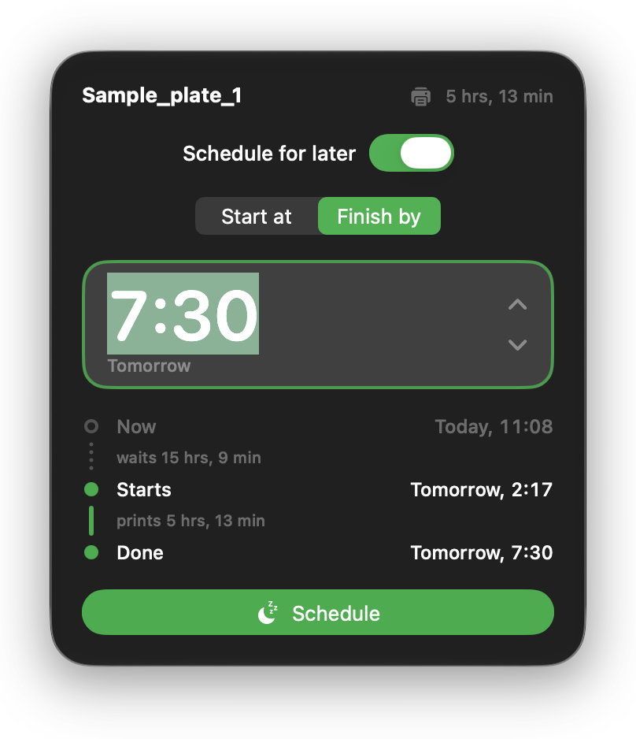

# Feierabend

Schedule Bambu Lab prints so they start, or finish, when you want them to.

  

Feierabend runs as a Bambu Studio post-processing script. After each slice, it asks whether to print right away or later. To print later, choose when the print should start or when it should be finished, and Feierabend adds a wait to the G-code before the machine start sequence. You press **Print** in Bambu Studio as usual, and Bambu Studio sends the job through Bambu Cloud. The printer stays cold until the planned start, then heats up and prints.

## Setup

1. `make install` builds Feierabend and copies it to `/Applications`.
2. Open Feierabend and copy the script line it shows.
3. In Bambu Studio, open the Process settings, turn on **Advanced**, go to **Others › Post-processing Scripts** and paste the line.
4. Save the process preset. The line belongs to the preset, so slicing with another preset doesn't ask.

Models without settings of their own, such as STL and STEP files, keep your current presets, so they use the saved preset with the line.

## Downloaded projects

A 3MF project, such as one from MakerWorld, brings its own process settings. When Bambu Studio opens it, those settings replace your preset, and with it the post-processing line. So Bambu Studio wouldn't run Feierabend after slicing the project.

Open those projects with Feierabend instead: drop them on its icon, or choose Feierabend under **Open With** in Finder. Feierabend adds its line to the project's settings, leaves every other setting as the designer saved it, and opens the project in Bambu Studio.

- Feierabend asks before it changes a file, unless you choose **Always add without asking**. The setup window turns the question back on.
- The file is changed in place, so saving in Bambu Studio and Recent Projects keep working. It's the same change Bambu Studio makes when you save a project with the line.
- Projects that already have the line, and plain 3MF files without project settings, open unchanged.
- To open every 3MF this way, choose **Get Info** on a 3MF file, pick Feierabend under **Open With** and click **Change All**.
- MakerWorld's **Open in Bambu Studio** button skips Feierabend, so download the file instead.
- Bambu Studio warns that the project contains post-processing scripts when you open it, unless you told it to always run them.

## How the wait works

- A single `G4` dwell on Bambu firmware is limited to roughly 90 seconds, so Feierabend writes one-minute `G4 S60` dwells.
- Each dwell is preceded by `M73 P0 R…`, so the printer and Bambu Handy include the wait in the remaining time.
- The wait sits between `; FEIERABEND_WAIT_START` and `; FEIERABEND_WAIT_END`, and a later run replaces it.
- **Finish by** uses Bambu Studio's `total estimated time` from the G-code header.
- The wait is counted from when the printer starts the job, so press Print soon after scheduling.
